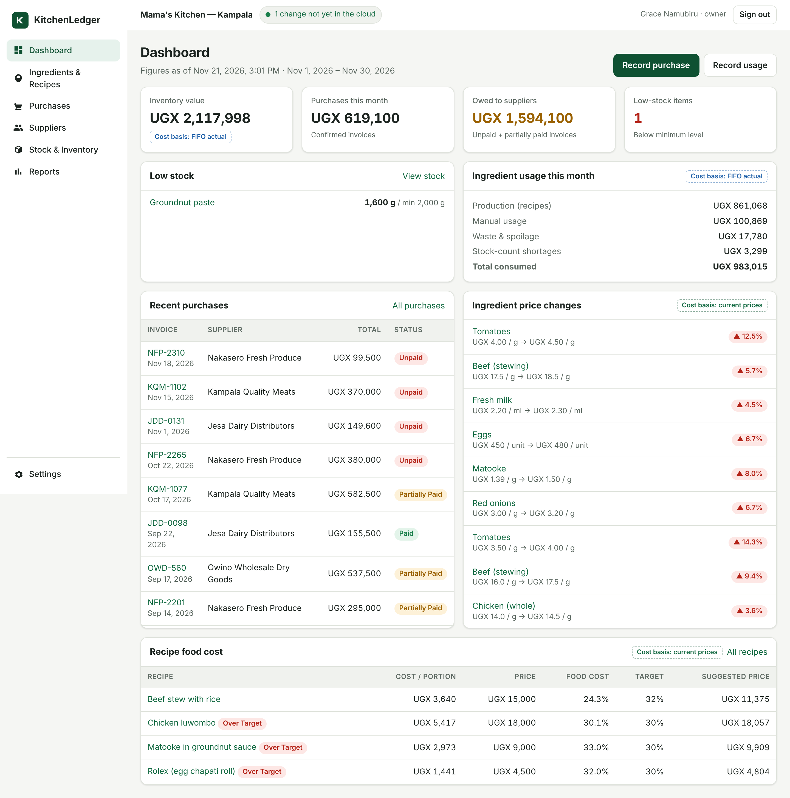

# KitchenLedger — Restaurant Costing, Purchasing & FIFO Inventory

One integrated, offline-first platform for restaurants:

1. **Ingredients & food costing**: ingredients, dimension-aware units, recipes with versions, yields, current-cost pricing.
2. **Purchasing & suppliers**: multi-line invoices, supplier balances, partial payments, credits.
3. **Stock & FIFO inventory**: automatic batches, oldest-first costing, production, waste, stock counts, valuation.

Enter information once: **confirming a purchase atomically** creates the stock batches, updates
ingredient prices and recipe costs, and updates the supplier balance.



## Status — Stage 3: hybrid offline/online ✅
* **Stage 2 (MVP):** costing, purchasing, suppliers, FIFO inventory, reports. All 14 acceptance criteria. [MVP report](docs/MVP-REPORT.md)
* **Stage 3 (hybrid):**
  * Each restaurant runs on its own server without internet.
  * Every transaction is captured atomically into a durable outbox and synchronised to a cloud. The cloud keeps an isolated read replica per branch, with central reporting and monitoring, and two-factor remote access.
  * Remote changes are executed by the branch, with explicit conflict rules; there is no last-write-wins.
  * Receipts are stored locally, then uploaded resumably with checksum verification.
  * 24 sync tests with real restarts, lost acknowledgements, interrupted uploads and database restores prove exact branch/cloud convergence.
  * See the [sync test report](docs/SYNC-TEST-REPORT.md), [architecture](docs/SYNC-ARCHITECTURE.md) and [recovery runbook](docs/SYNC-RUNBOOK.md).

| | |
|---|---|
| Install & operate | [docs/INSTALL.md](docs/INSTALL.md) · [sync recovery runbook](docs/SYNC-RUNBOOK.md) |
| API | [docs/API.md](docs/API.md) · OpenAPI [branch](docs/api/openapi.json) / [cloud](docs/api/openapi-cloud.json) · live at `/api/docs` |
| Database | [migration](backend/migrations/versions/) · [design](docs/02-database-design.md) |
| Test results | [docs/test-results.txt](docs/test-results.txt) |
| Architecture & decisions | [docs/01-architecture.md](docs/01-architecture.md) · [ADRs](docs/adr/) · [business rules](docs/03-business-rules.md) |
| Roadmap | [docs/05-roadmap.md](docs/05-roadmap.md) |
| Legal research notes (Uganda, Eritrea; not legal advice) | [docs/07-legal-and-compliance.md](docs/07-legal-and-compliance.md) |

## Quick start (developer)
```bash
cd backend && python -m venv .venv && .venv/bin/pip install -r requirements.txt pytest httpx
```
```bash
.venv/bin/alembic upgrade head && .venv/bin/uvicorn app.main:app --port 8000
```
```bash
cd frontend && npm ci && npm run dev
```
Then open http://localhost:5173. Optional demo data: `backend/.venv/bin/python scripts/seed_demo.py`.

## Stack
React 18 + TypeScript PWA (TanStack Query, IndexedDB drafts) · Python FastAPI modular monolith · SQLAlchemy 2 + Alembic ·
PostgreSQL 16 (branch + cloud, schema per branch) · transactional outbox sync worker · Docker Compose + Caddy (HTTPS).
