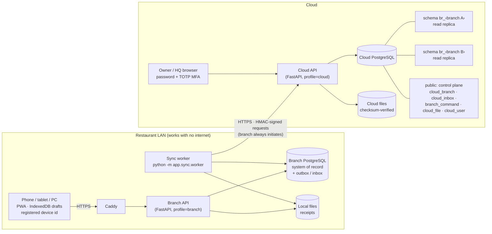
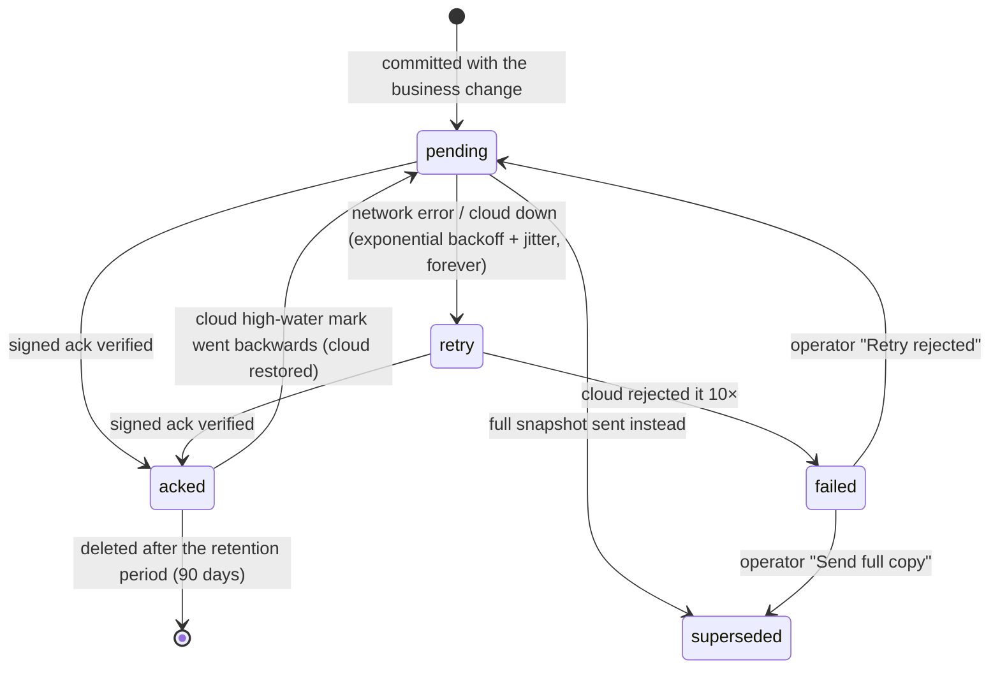
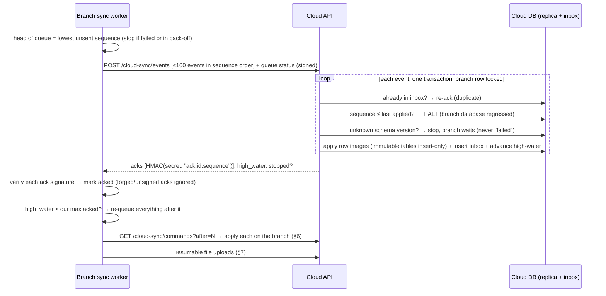

# Hybrid Architecture & Synchronisation

Status: **implemented and tested (Stage 3)** · decisions in [ADR-0009](adr/0009-change-capture-sync.md) (refines [ADR-0003](adr/0003-offline-first-branch-authority.md))

## 1. Principles

1. **The branch server is the system of record** for everything that happens in its restaurant.
   It needs no internet: local PostgreSQL, local API, local login, local files, local reports.
2. **The cloud never writes branch business data.** It holds a read replica per branch, receives
   immutable events, and serves central reporting and monitoring.
3. **Remote management is done by commands.** The branch executes them with its own business
   rules and locks, and conflicts are explicit. There is no last-write-wins anywhere.
4. **Nothing is deleted before a verified acknowledgement.** Every queue is durable PostgreSQL state.

## 2. Deployment



* **Isolation:** each branch's data lives in its own PostgreSQL schema, created with the *same* migrations the branch runs. Cloud users can be scoped to specific branches.
* **Transport:** the branch always opens the connection, so no inbound firewall rules are needed at the restaurant. Requests carry `X-Branch-Id`, `X-Timestamp` and `X-Signature = HMAC-SHA256(secret, ts·method·path·sha256(body))`. Requests are rejected if more than 5 minutes old.
* **Secrets:** the cloud stores no branch secrets; it derives them as `HMAC(master key, branch id, version)`.

## 3. Every operation is identified

Each committed business transaction produces **exactly one outbox record** in the same database transaction:

| Field | Meaning |
|---|---|
| `id` | global transaction id (UUIDv7) |
| `branch_id`, `device_id`, `user_id` | where, on what device, by whom. Writes are refused without a registered, non-revoked device. |
| `created_at`, `topic` | commit time and operation type (`purchase.confirmed`, `payment.posted`, `cloud.ingredient.update`, …) |
| `schema_version` | Alembic revision that produced the row images |
| `sequence` | commit-ordered position (see §4) |
| `status`, `attempts`, `next_attempt_at`, `last_error`, `acked_at`, `ack_signature` | synchronisation state |
| `payload.rows` | final row images of every inserted, updated or deleted row, in dependency order |

Idempotency keys (from the device) stop duplicate *submissions*. Event ids and the cloud inbox primary key stop duplicate *deliveries*.

## 4. Transactional outbox with commit-ordered sequence

```mermaid
sequenceDiagram
  participant D as Device
  participant A as Branch API
  participant DB as Branch PostgreSQL
  D->>A: POST /purchases (Idempotency-Key, X-Device-Id)
  A->>DB: BEGIN; lock rows; insert invoice, lines, batches, movements, ledger, audit…
  Note over A: mapper hooks record every INSERT/UPDATE/DELETE (dependency order)
  A->>DB: before_commit: flush; pg_advisory_xact_lock(OUTBOX)
  A->>DB: INSERT outbox_event(sequence = nextval, rows = final images)
  A->>DB: COMMIT  (business change + outbox record, or neither)
  A-->>D: 201 (only after COMMIT)
```

The advisory lock is held from sequence assignment until COMMIT, so **sequence order equals commit
order**. A transaction can never become visible with a lower sequence than one already sent, which is the
classic outbox reordering bug. Mutations are collapsed per row:
* insert then update → upsert;
* insert then delete → nothing;
* delete then re-insert → upsert. This last case was found by the live two-server run and is now covered by a regression test.

## 5. Push, acknowledgement and queues





* **Dependency order:** events are applied strictly in sequence. A rejected event blocks later ones until an operator acts, because applying later changes without their predecessor could corrupt the replica.
* **Backoff:** `uniform(1 s, min(900 s, 2·2^attempts))` (full jitter). Connectivity failures never make an event "failed".
* **Heartbeat:** with nothing to send, the worker still contacts the cloud. The cloud uses this to show the branch as online, and the branch learns the cloud's high-water mark.
* **Recovery after restarts:** there is no in-memory state. A crash between "cloud applied" and "branch recorded the ack" leads to a re-send, a duplicate ack and no duplicate data.

## 6. Remote management and conflict policies

| Situation | Policy | Test |
|---|---|---|
| Two devices submit the same purchase | Same idempotency key → one purchase; the other gets a replay. A different key for the same supplier invoice → 409. | `test_simultaneous_devices…` |
| Concurrent stock consumption | Serialised per ingredient by a row lock on `stock_item`, then FIFO under `FOR UPDATE`. A batch can never be consumed twice or go negative. | MVP concurrency tests + sync test |
| Concurrent payments (branch + cloud) | Cloud sends a `payment.post` command. The branch validates it against its live ledger under invoice row locks; over-allocation → **rejected**. | `test_remote_payment_cannot_overpay…` |
| Ingredient / supplier edits | The command carries the `version` the cloud user saw; a mismatch at the branch → **conflict**, nothing overwritten. | `test_remote_ingredient_edit_conflict…`, live E2E |
| Recipe version updates | The command carries the latest version number seen; a newer version at the branch → **conflict**. Published versions are immutable anyway. | `test_recipe_version_and_branch_settings…` |
| Branch configuration | `settings_version`, bumped by every local change → **conflict** on mismatch | same |
| Ingredient price updates | Append-only price history; the current cost is the **newest effective date**, whatever the arrival order | `test_price_updates_newest_effective_date…` |
| Command delivered twice | Branch inbox primary key → applied once | `test_duplicate_command_delivery…` |
| Posted financial/stock record wrong | Never edited: void/reversal/credit transactions only (DB triggers block UPDATE/DELETE on movements, allocations, ledger, audit) | MVP tests |

A command's result travels back in the **same outbox event** as the changes it made, so the cloud
shows `applied | conflict | rejected` only once the branch has actually committed.

## 7. Offline documents (receipts)

1. The photo or PDF is validated by **content** (magic bytes, ≤ 10 MB) and written atomically (temp file, fsync, rename) to local disk, with SHA-256 recorded. This works with no internet.
2. Metadata replicates as normal rows. The bytes go separately: `GET` the cloud's received offset, then `PUT` 256 KB chunks with `offset`. An interrupted upload **resumes from the cloud's offset**.
3. `complete`: the cloud checks size, SHA-256 and the replicated metadata row, then returns a signed receipt. Only then does the branch set `cloud_verified_at`. A corrupted transfer is discarded and re-sent.
4. The UI shows **"saved locally"** and, separately, **"in cloud ✓"** only after that verification.

## 8. Snapshot, recovery and upgrades

* **Snapshot:** a full ordered copy of all replicated tables, in chunks of 500 rows. It is used at registration, after an upgrade from pre-sync versions, or on operator request. It is written under the outbox lock and supersedes unsent changesets (their effects are inside it). The cloud empties the branch replica and applies it in one transaction per chunk.
* **Cloud restored from an old backup:** the branch sees the cloud's high-water mark is lower than its acked events, re-queues them (they are retained for 90 days) and converges. If the cloud is older than the retention window → re-snapshot.
* **Branch restored from an old backup:** run `restore-from-cloud` **before opening**. It replays the cloud's copy of newer events and moves sequences past them. If the branch skips this and creates new events, the cloud **halts** on the sequence regression instead of merging, and both sides keep every event (see the runbook).
* **Software upgrade:** upgrade the **cloud first** (it migrates every replica schema and accepts schema versions N and N−1). Events from a newer branch schema wait (status `retry`) until the cloud is upgraded; they are never dropped.

## 9. Monitoring

* **Branch:** `GET /api/v1/sync/status` and the Settings → Cloud sync screen show queue sizes, oldest unsent change, rejected events, last success and last error. `/health/ready` includes `sync_pending_events`, `sync_failed_events` and `sync_halted`. The top bar indicator shows one of: *All changes synced · N min ago* / *N changes not yet in the cloud* / *needs attention* / *server unreachable — drafts only*.
* **Cloud:** each branch has a health state (`in_sync`, `catching_up`, `offline` (no heartbeat for 15 min), `error`, `halted`), the last applied sequence, data-as-of time, the branch's reported queue, and recent events, commands and file states.
